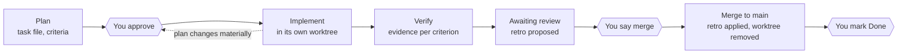

# claude-workflow

A Claude Code plugin for working with Claude on real projects: every non-trivial change is planned,
approved, built in its own git worktree, verified with evidence, and reviewed, and every task feeds
lessons back into the process itself.

The project's files, not the chat, are the source of truth. Any fresh session can read them and pick
up exactly where the last one stopped.

| Problem | What prevents it |
|---|---|
| A session is lost (crash, restart, context runs out) and the plan goes with it | Each task file has a status block accurate enough to resume from alone |
| Claude says something works without proof | Every success criterion says how it will be checked; Verification records the evidence |
| Work grows past what was agreed | Plans are approved before work starts; anything new goes to the backlog |
| Two pieces of work collide | Each task runs in its own git worktree; shared files are declared up front |
| The same mistakes repeat | Lessons become fixes at every hand-off, and each phase ends with a process review |

## Install

Requires the [Claude Code CLI](https://code.claude.com/docs/en/quickstart) (`claude --version`).

```sh
claude plugin marketplace add PatrickSouthern/claude-workflow
claude plugin install workflow@claude-workflow
```

This installs at user scope: the skills are available in every project on the machine, as
`/workflow:<skill>`. To update later, refresh the marketplace, update the plugin, then restart
Claude Code:

```sh
claude plugin marketplace update claude-workflow
claude plugin update workflow@claude-workflow
```

**On a work or enterprise account**, check first that your organization's managed settings allow
third-party marketplaces ([plugin policy for organizations](https://code.claude.com/docs/en/plugins/org)).
If they don't, the files under `plugins/workflow/` can be copied into a project's `.claude/skills/`
by hand, or the repo mirrored into your organization's own marketplace.

## Set up a project

In the project's root (a git repository), start Claude Code and run:

```text
/workflow:setup
```

It asks for a few project specifics (proposing defaults from what it finds, such as `bin/`, `obj/`
and `node_modules/` for a .NET and React app), then writes:

| File | What it holds |
|---|---|
| `CLAUDE.md` | A "How we work" section: when a task file is needed, the always-rules, which skill applies when, how to capture lessons, and the project's specifics. Inserted into an existing `CLAUDE.md`, never replacing it |
| `docs/ROADMAP.md` | Phases with a goal each, the tasks in order with their status; every phase ends with a process review |
| `docs/tasks/_TEMPLATE.md` | The task file every task starts from |
| `docs/tasks/BACKLOG.md` | Follow-ups found during tasks, each with its source and when to pick it up |
| `docs/PROCESS-LOG.md` | Every change to the way of working, with how we'll know it worked |
| `docs/runbooks/` | How recurring operations (deploy, migrations, releases) last worked |
| `.claude/settings.json` | `worktree.baseRef: "head"` and read-deny rules for generated folders (merged into existing settings; depending on your permission mode, Claude Code may ask you to approve this write) |
| `.gitignore` | `/.claude/worktrees/` |

Then start a new session (so the settings apply) and plan the first task with `/workflow:task`.

## The skills

| Skill | When | What it does |
|---|---|---|
| `/workflow:setup` | Once per project | Adds the workflow files (above) |
| `/workflow:task` | Starting non-trivial work; again when you approve the plan | Numbers and plans the task, checks overlap and the backlog, stops for approval; on approval, commits the plan and creates the worktree |
| `/workflow:finish-task` | The work is believed complete | Runs every criterion's check, records evidence, completes the retro, hands off as `Awaiting review` |
| `/workflow:merge-task` | You say "merge" | Applies the retro fixes you approved, merges with `--no-ff`, runs post-merge checks, removes the worktree |
| `/workflow:close-task` | You say "Done" | Moves follow-ups to the backlog, updates the roadmap |
| `/workflow:review-process` | A roadmap phase ends | Checks whether process changes worked, prunes, questions the rules |

Claude invokes the task skills on its own when the moment comes ("merge" and "Done" only on your
explicit word). `setup` runs only when you type it.

## The task lifecycle



Claude stops three times for you: to approve the plan, to say "merge", and to mark the work Done.

**What needs a task file:** more than one step, a design choice, or more than a couple of files
changed. Typo fixes, one-line changes and questions skip it.

### The status block

The top of every task file is written so a fresh session can resume from it alone:

```markdown
**Status:** In progress — worktree 003-code-structure
**Last updated:** 2026-10-13
**Next step:** Run the test suite in the worktree
**Blockers:** none
**Worktree:** `.claude/worktrees/003-code-structure`, branch `worktree-003-code-structure`
```

The status line keeps the exact format `**Status:** <value> — <detail>`, so
`grep -r "\*\*Status:\*\*" docs/tasks/` shows every task's state at once. Values: `Planned`,
`In progress`, `Blocked`, `Awaiting review`, `Done`, `Abandoned` (with the reason).

### Criteria that prove something

A good criterion names the check and what a pass looks like. The strongest also prove the check can
fail: break something on purpose, show the tool catches it, then undo it.

- Weak: "Tests work."
- Strong: "`run-tests` catches failures — *with a deliberately failing temporary test it exits
  non-zero and names the test and its message; the temporary test is removed after*."

## Roadmap and backlog

The roadmap says what comes next and in what order; the backlog holds what was found along the way.
Work in progress lives only in task files.

- **Phases, each with a goal**, each ending with a process review. Phase 0 is usually foundation: a
  project where Claude can make a change and prove it works without you acting as its eyes
  (structure, tests, build, a way to see the running app).
- **Numbers only when planned.** Future rows show `—`; a task gets its number when its file is
  created.
- **Direction needs your agreement.** Adding, removing or reordering work is your call.
- **A follow-up never holds a task open.** It goes to the backlog when the task is Done, as
  `Bn — title · from NNN · when: <condition>`. The "when" is what makes the backlog useful.
- **Planning checks the backlog**, and covered entries move to Closed with the task number.

## Runbooks

A runbook records how a recurring operation was last done successfully (deploy to the Azure test
slot, run database migrations, cut a release), so the next session follows it instead of
rediscovering it. Claude checks for one before a routine operation, writes one when a task works out
a repeatable procedure, fixes it when a step fails (with the failure in Known problems), and keeps a
`Last verified` date. Exact commands with expected output; secrets never, only their names. When a
runbook becomes a fixed list of commands, turn it into a script and let the runbook shrink to
running and checking it.

## How the process improves itself

Every lesson becomes a concrete change, approved with the task that found it; every change is
checked later and kept, changed or dropped.

**Capture when it happens.** Three signals add a Retro item to the current task right away: you
correct how Claude works; the same kind of failure happens twice; the workflow or tools surprise
Claude or cost time. With no task open, the lesson becomes a backlog entry.

**Fix with the strongest mechanism.** Each retro item (at most three per task) names its fix, where
it lives, and how we'll know it worked. Guard the condition that caused the failure, not the whole
action: ban an action only when the condition can't be checked. Prefer, in this order:

| Mechanism | Example | Why this rank |
|---|---|---|
| Hook or enforced setting | Read-deny rule for `bin/`, `obj/`, `node_modules/` | Runs every time; Claude can't forget it |
| Script or test | A check script that fails loudly instead of printing OK | Runs on demand and proves itself |
| Template | A new field in the task template | Shows up in every task |
| Skill | A step added to `finish-task` | Loaded exactly when the procedure runs |
| Runbook | A Known problems row | Found when the operation is repeated |
| `CLAUDE.md` rule | "Verify settings changes after merge" | Advisory, and costs context every session |
| The workflow plugin | A change proposed to this repo | Reaches every project on the next update |

**Approve, apply, log.** You approve retro items with the task. On "merge", Claude applies them and
adds a row to `docs/PROCESS-LOG.md`: the change, the mechanism, and how we'll know it worked.

**Review at the end of every phase** (`/workflow:review-process`), as a task like any other:

1. **Did each change work?** Evidence from the task files since; verdict kept, changed or dropped.
2. **Did a lesson repeat?** Then its fix was too weak: move it up the ladder.
3. **What can be pruned?** `CLAUDE.md` stays under 100 lines (Anthropic's guidance is under 200);
   anything needed only sometimes moves to a skill or runbook. `/doctor prompt-audit` finds
   contradictions and stale references.
4. **Which rules cost more than they give?** Simplify or drop them. Most processes only ever add rules.

Lessons that would help every project come back here, as an issue or a change to this repo.

**Where this comes from:**
- Retrospectives fail on follow-through: few items, each with an owner and a check, and the last ones
  reviewed first. [Scrum.org](https://www.scrum.org/resources/blog/ditch-unfinished-action-items)
- "Good intentions don't work; mechanisms do": a tool, its adoption, and an inspection that it
  works. [Kindel](https://blog.kindel.com/2020/03/06/mechanisms/)
- Compound engineering's test for a captured lesson: would the system catch this automatically next
  time? [Every](https://every.to/guides/compound-engineering)
- Claude Code's docs: `CLAUDE.md` is advisory and should stay short and pruned; hooks enforce; skills
  load on demand. [Best practices](https://code.claude.com/docs/en/best-practices),
  [Extend Claude Code](https://code.claude.com/docs/en/features-overview)
- Single-loop learning fixes errors within the rules; double-loop learning questions the rules.
  [Argyris on infed.org](https://infed.org/dir/chris-argyris-theories-of-action-double-loop-learning-and-organizational-learning/)

## Parallel work with worktrees

Every task is implemented in its own git worktree, so several Claude sessions can work at once
without sharing a working directory or build.

1. **Plan in the main checkout, on `main`.** Only it creates task files, so numbers never clash. The
   task's **Touches** field lists the shared files it expects to change (for a web app: EF Core
   migrations, `appsettings*.json`, the lockfile).
2. **Check overlap before approval.** Tasks touching the same shared files run one after another.
3. **After approval**, the task file is committed to `main` and the worktree is created with Claude
   Code's built-in support at `.claude/worktrees/NNN-short-name/` on branch
   `worktree-NNN-short-name`, from the current `main` commit (`worktree.baseRef: "head"`).
4. **Implement in the worktree.** Its task file is the live copy; a task never edits another task's
   files or branch.
5. **Merge on your word**, with `--no-ff` so each task stays visible in history.

Keep worktree names short (`NNN-` plus two or three words): deep tool caches inside a worktree can
push Windows past its 260-character path limit.

## Gotchas

- **Settings changed inside a worktree apply only after the merge.** A session keeps the settings of
  the checkout it started in. Make such checks post-merge criteria.
- **Skills, unlike settings, are picked up mid-session**, including skills added in a worktree.
- **The project's `.claude/` folder is a protected path**, and allow rules don't pre-approve writes
  to it. Manual and `acceptEdits` modes ask first; `auto` mode lets its classifier decide, so it may
  write without asking; `dontAsk` refuses. A headless `acceptEdits` run can't write there at all.
  ([Protected paths](https://code.claude.com/docs/en/permission-modes#protected-paths))
- **A crashed session leaves its worktree locked.** If the locking process no longer exists, the lock
  is stale and `git worktree remove -f -f` is safe once the branch is merged.
- **Worktree removal can end in "Permission denied" on Windows.** Git has already unregistered and
  emptied the worktree; only the folder is left, held by a shell's working directory. Remove the
  empty folder, then delete the branch.
- **Worktree isolation refuses complex inline commands.** Put multi-step checks in a script file.
- **A broken tool must never report success.** Check scripts stop on their own errors, and plans
  include a deliberate failure to prove each check can fail.
- **Generated files that differ per checkout** (editor settings that embed the folder name) produce
  bogus diffs in every worktree. Ignore them in git.

## Personal rules that pair well

These belong in your user-level `~/.claude/CLAUDE.md`, so they apply to every project:

- Follow best practices: use the standard, well-supported way when there is one.
- Don't work around missing tools or access; stop and say what's needed.
- Fix root causes of repeated errors, not each instance.
- Edit files with the Edit and Write tools, not shell string replacement.
- Put non-trivial code in script files rather than inline shell snippets.

## Developing this plugin

This repo uses its own workflow: see [CLAUDE.md](CLAUDE.md), [docs/ROADMAP.md](docs/ROADMAP.md) and
[docs/tasks/](docs/tasks/).

- Load the working copy for one session: `claude --plugin-dir ./plugins/workflow`, and
  `/reload-plugins` after edits.
- Validate: `claude plugin validate ./plugins/workflow` and `claude plugin validate .`
- Trial the setup skill: `sh tools/trial-setup.sh <scratch dir> fresh|existing`
  ([runbook](docs/runbooks/run-setup-trials.md)).
- Release: [docs/runbooks/release.md](docs/runbooks/release.md).

Lessons from projects using the plugin are welcome as issues.

## License

[MIT](LICENSE)
